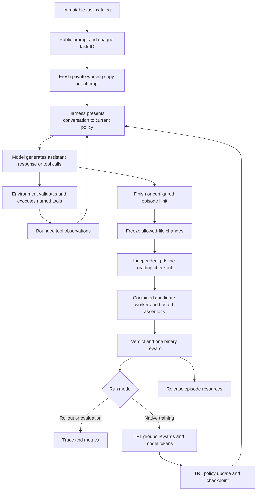
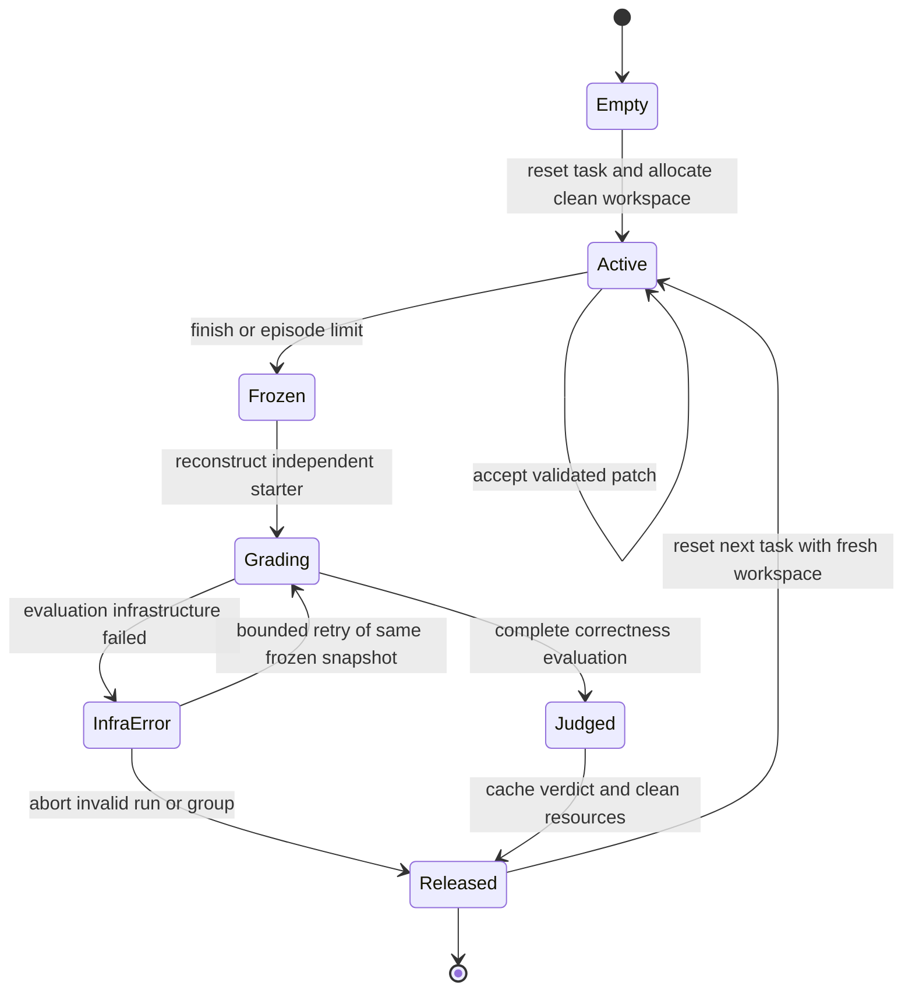

# Architecture and mental model

Current model/harness commands and empirical limits are in [the training guide](TRAINING_GUIDE.md) and [Phase 4 status](PHASE_4_STATUS.md).

Status: original architecture design. The core, CPU inference/evaluator and native
training implementation are present. [Phase 3 status](PHASE_3_STATUS.md) separates
fixture validation from genuine target-model acceptance; [Phase 4](PHASE_4_COMPLETION_PLAN.md)
consolidates the remaining work. Examples below remain conceptual where labeled.

## 1. A coding environment is a changing repository

Imagine an issue: a timeout helper should preserve an explicitly supplied zero, but currently replaces it with a default. The agent starts with the issue text and a private starter repository. It must discover the relevant file, inspect it, change it, and test its change.

The repository is the world. The model is the decision maker. The harness connects generated decisions to tools. A sandbox executes code within limits. A verifier decides whether the submitted change is correct. GRPO changes the model's weights after several such attempts.

Changing a prompt does not change a file. Saying “fixed” does not change a file. Only an accepted state-changing tool action changes the authoritative working copy. The final chat response is not the submitted solution; the frozen repository changes are.

| Term | Concrete meaning in the timeout task |
|---|---|
| Task | Stable issue, starter revision, allowed files, visible tests, private evaluation plan, and budgets |
| State | Current source files, accepted edits, task identity, counters, and lifecycle status |
| Observation | The bounded text the agent receives, such as file contents or visible test output |
| Action | A generated call to a named tool with arguments |
| Episode / rollout | One independent attempt from reset until finalization |
| Trajectory | Ordered observations, generated responses, tool calls/results, termination, final changes, and verdict |
| Terminal reward | One trusted correctness value for the frozen attempt |
| GRPO group | Several independent attempts at the same task and starter revision |
| RL batch | One or more groups, plus trainer-owned tokens, masks, probabilities, and rewards used for updates |
| Policy version | Identity of the exact model weights used to generate an attempt |

State is larger than observation. The agent sees a file only after reading it and sees test results only after running visible tests. Hidden expected values, private assertions, other episodes, and host configuration never enter its normal observations.

Keep state small. The first tools do not provide a persistent shell or background processes. Each test call executes a disposable worker against a read-only snapshot; the next tool call sees the same authoritative source unless `apply_patch` accepted another edit.

## 2. Ownership makes the design understandable

| Component | Owns | Inputs and outputs |
|---|---|---|
| Task catalog | Immutable teaching fixtures, revisions, splits, and protected grading references | Task ID becomes a task definition |
| Coding environment | Episode state, file operations, limits, freeze, and terminal verification coordination | Tool call becomes a state change or bounded observation |
| Sandbox | Workspace allocation and contained process execution | Snapshot plus allowed test plan becomes bounded process results |
| Harness | Conversation construction, generation, parsing, tool dispatch, and turn accounting | Observation becomes a model decision |
| Verifier | Independent reconstruction and executable correctness checks | Frozen changes become a verdict and binary reward |
| Recorder | Ordered public trace and developer metadata | Events become JSONL and artifact references |
| TRL | Native training generation loop, learning tensors, grouping, and optimizer | Valid rollout groups become policy updates |
| Evaluator | Held-out protocol and summary metrics | Checkpoint plus held-out tasks becomes a report |

Use ordinary functions and small classes. A thin adapter translates the core into TRL's interface. A sandbox strategy and a harness protocol are useful when there are actual alternatives; a registry, event bus, service framework, or generic agent superclass adds no value here.

## 3. The complete loop

The verifier runs after freezing. A visible test call is part of the observation loop; private grading is outside that loop. During training, TRL owns the generate, parse, dispatch, and repeat sequence. During the CPU inference lesson, a small manual harness owns that sequence. Neither path implements the GRPO objective itself.

The diagram combines rollout and training at the conceptual level. A new training update begins a new collection round using the current policy and fresh episode states; it never resumes a graded workspace.

## 4. Environment lifecycle

Lifecycle status, termination reason, and verifier verdict are different fields. An episode can stop because its tool budget ended, yet have a valid final artifact. It must be judged and reported with that limit reason. A malformed or incomplete patch is never applied. A context cutoff is not equivalent to an explicit final response.

An accepted final snapshot is graded for correctness even if a limit caused finalization; verified success then remains explicitly marked as a limited episode. Training eligibility for truncated token sequences is governed separately by the tested trainer's masking policy. Candidate resource violations receive an explicitly classified failing verdict. Infrastructure failures have no correctness reward.

No tool mutates a frozen episode. Repeating terminal verification returns the cached completed verdict. Retrying an infrastructure failure evaluates the same snapshot; starting another rollout resets to the starter.

## 5. Worked episode: read, fail, correct, verify

This is an intended teaching example, not observed output. Expected fixture counts must be replaced with measured results when the fixtures exist. The explanation reveals the concept to a human reader; training prompts contain only the user-facing issue.

| Event | Agent-visible content or action | Private state / lesson |
|---|---|---|
| Task selected | Preserve an explicit zero timeout; preserve existing behavior for omitted values | Select immutable `zero-timeout` starter |
| Reset | Issue prompt is ready | Allocate episode A; source hash equals starter hash |
| List | Agent requests file listing | Return only allowed repository names |
| Read | Agent reads `timeout.py` | File text becomes observation; source remains unchanged |
| First edit | Agent changes zero handling but accidentally changes omitted-value behavior | Accepted patch changes only this episode's source |
| Visible test | Agent requests `run_tests` | Worker executes the authored visible suite; returns a bounded failing result |
| Second edit | Agent repairs both required behaviors | Source changes again; no previous worker state is reused |
| Visible test | Agent requests `run_tests` again | Visible suite passes; this is useful feedback, not a final reward |
| Final response | Agent says it has completed the task | Freeze actual allowed source changes, regardless of the claim |
| Private grading | No hidden feedback is added to model messages | Rebuild clean starter plus changes; private assertions also check additional edge cases |
| Reward | Logged for developer/trainer | Reward 1.0 only for a valid independently verified solution |
| Cleanup | Developer trace confirms release | Delete episode and grading resources; keep frozen artifact and verdict |
| Reset again | Same issue appears in episode B | Initial hash equals starter hash; episode A's edits are absent |

The first failing test matters because an agent can revise a decision using an observation. GRPO still receives one terminal reward for the whole attempt; this draft adds no intermediate shaping reward for test runs, style, verbosity, or confidence.

## 6. How a group produces a learning signal

For a teaching group of four attempts, all four use the same task ID, starter revision, tools, budgets, and private grading plan. They differ in sampled assistant actions and therefore may produce different patches.

Suppose the rewards are 1, 0, 1, 0. The mean is 0.5. The two successful attempts receive positive group-relative advantages; the two unsuccessful attempts receive negative advantages. The exact normalized magnitudes depend on TRL's pinned standard-deviation convention and configuration. Describe the signs before worrying about the implementation formula.

If all rewards are zero, or all are one, the group contains no relative correctness information. With zero KL coefficient and no additional objectives, the group provides no correctness-driven policy update. A configured KL term may still contribute a gradient. Measure the proportion of equal-reward groups; do not fabricate mixed rewards to make a training demonstration appear successful.

This is the relationship between RLVR and GRPO: RLVR supplies a reward you can check by execution; GRPO supplies the policy update using comparisons between attempts. A reward model, critic network, or handcrafted GRPO loss is unnecessary for the initial lab.

The original [DeepSeekMath paper](https://arxiv.org/abs/2402.03300) introduces GRPO. The project uses the library implementation and verifies its selected loss configuration rather than reproducing the paper's optimizer.

## 7. Human traces and learning data have different purposes

| Data | Human trace | Native trainer |
|---|---|---|
| Public task issue and ID | Explain the attempt | Establish shared task conditioning |
| Tool names and arguments | Explain decisions and validate bounds | Model-generated call tokens can be part of the action sequence |
| File/test output | Explain observations | Condition later actions; no direct policy loss on environment output |
| Assistant text | Show generated behavior | Generated tokens participate according to trainer masks |
| Token IDs and assistant/tool masks | Optional references or compact diagnostics | Required for exact sequence alignment |
| Behavior/current/reference log probabilities | Usually metrics or protected tensor artifacts | Required as applicable to the chosen supported objective |
| Final snapshot and diff | Explain what was submitted | Reward is tied to this immutable artifact |
| Verdict and reward | Explain outcome | One scalar per valid rollout, in the correct group ordering |

Masking tool-output positions means they do not become actions to imitate. The model still learns to choose actions conditioned on those observations. A transcript re-tokenized later is not guaranteed to reproduce the exact sampled sequence, especially when chat templates rewrite prior turns. Preserve training data through native TRL, not through reconstructed JSONL.

## 8. Source layout

| File or directory | Why it exists |
|---|---|
| `pyproject.toml` | Package metadata and mode-specific optional dependencies |
| `configs/default.yaml` | One source of operational settings; CLI applies explicit overrides |
| `src/config.py` | Load, validate, and resolve mode-specific settings |
| `src/tasks/catalog.py` | Load immutable fixture metadata and train/evaluation partitions |
| `src/environments/execution/sandbox.py` | Workspace ownership and bounded Docker execution |
| `src/environments/coding.py` | Readable reset, tools, counters, freeze, and terminal reward lifecycle |
| `src/environments/verifier.py` | Rebuild the final candidate and run protected executable checks |
| `src/utils/trace.py` | Event schema, JSONL recording, artifact references |
| `src/harnesses/` | Scripted and external agent drivers plus the shared tool protocol |
| `src/coding_rl/rollout/` | Transformers model episodes, diagnostics and evaluation |
| `src/coding_rl/training/adapter.py` | Narrow adapter exposing the four named tools and reserved lifecycle methods |
| `src/coding_rl/training/trainer.py` | Translate validated config into the tested TRL contract |
| `src/main.py` | Small commands for demo, smoke, inspection, rollout, training, and evaluation |
| `src/tasks/fixtures/` | Public starters and protected authored grading material, kept separate from candidate execution |
| `tests/` | Environment, sandbox, adapter, and training acceptance checks |
| `outputs/` | Traces, frozen submissions, metrics, manifests, and checkpoints |

Merge a module when its contents are trivial. Avoid putting unrelated state transitions, model loading, and optimizer setup into one large class. The first file a learner opens should remain `src/environments/coding.py`.

## 9. Extension points and limits

Add a task by defining a new immutable starter, user issue, allowed source files, visible suite, private cases, and split membership. Validate the buggy baseline and known-good human solution before exposing it to a model.

Add a tool only when the four initial tools cannot express the intended task. Its schema, path bounds, costs, output caps, and model-facing errors belong with the environment. Add the named method to the adapter and assert the complete discovered tool set. A general shell is a later scope change.

Add a harness by implementing the rollout/evaluation contract. Add a new reward rule only by versioning the verifier and documenting its semantics; the first release remains binary correctness. Add a backend by meeting the same snapshot, process-limit, observation, and cleanup behavior.

CPU Transformers inference is the default model lesson. CPU full training remains an explicit measured experiment; a sub-billion-parameter checkpoint does not guarantee fast generation or affordable optimizer memory. Optional CPU vLLM and external harnesses remain evaluation paths until their native training integration is proved. See [the training plan](04_TRAINING_AND_CPU_BACKENDS.md).

OpenEnv and Agent Lightning are references for later extensions, not dependencies of the first implementation. The [OpenEnv training guide](https://huggingface.co/docs/openenv/guides/training) describes environment-centered training; [Agent Lightning's repository](https://github.com/microsoft/agent-lightning) provides an agent/training integration reference. Borrow the separation of responsibilities without adding their infrastructure to the local lab.

## 10. Small design patterns with concrete purposes

| Pattern | Use here | Keep it small |
|---|---|---|
| Explicit state machine | Active, frozen, grading, judged, and released phases determine legal operations | One phase field and clear checks; no state-machine framework |
| Adapter | Translate the core into TRL's named tools and reserved lifecycle | Delegate behavior; do not duplicate reset or grading logic |
| Strategy / protocol | Choose Docker versus trusted-local execution, or minimal versus custom evaluation driver | Add a protocol only when there are real alternative implementations |
| Immutable snapshot | Tie verification and reward to the exact final source | Store allowed file bytes and hashes; prohibit post-freeze mutation |
| Resource owner | One episode owner allocates and reliably releases its directories/workers | Guaranteed cleanup paths and idempotent release |
| Value records | Represent task, tool result, verdict, and episode summary | Typed records rather than an inheritance hierarchy |

These patterns exist to explain ownership and correctness. A learner should be able to follow reset, one tool call, and finalization by reading a few ordinary functions.
