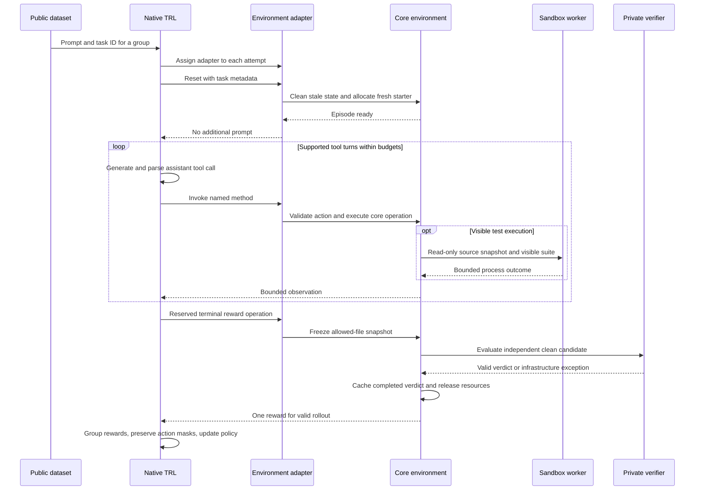

# Environment support: core, harness, and TRL

Status: design draft. Official documentation reviewed on **2026-10-14**; no installed TRL version has been tested in this repository. A release must replace the pending compatibility record with exact versions and actual results.

The core, scripted commands and native TRL adapter are implemented. [Phase 3 status](PHASE_3_STATUS.md) records installed native fixture tests and remaining target-model gates; [Stage A status](PHASE_A_STATUS.md) retains the original environment validation.

Implementation update, **2026-10-16**: `trl_env.py` and `trainer.py` implement the installed TRL 1.16.0 contract with public admission/loss hooks. The conceptual guidance below is historical; the [Phase 3 run guide](PHASE_3_STATUS.md) specifies the tested native batching/parser/call semantics and distinguishes them from the manual evaluator.

## 1. One environment core, one training adapter

The framework-independent core owns the authoritative files and the episode lifecycle. It understands a stable task ID, tools, counters, finalization, and verification. It knows nothing about gradients, optimizer states, or a particular model provider.

The TRL adapter holds that core privately and translates its four tools and two reserved lifecycle operations into the trainer interface. A no-argument factory closes over immutable configuration and the task catalog. Each factory-produced adapter owns one core; it cannot share a writable workspace with another adapter.

Treat the adapter object and the episode as different lifetimes. Reusing an object is fine only when resetting it releases stale resources and creates a new clean episode. Keep construction cheap; allocate working copies in reset.

The default public dataset contains a conversational user prompt and an opaque `task_id`. The task catalog resolves that ID to the immutable starter and grading plan. Private assertions, expected answers, filesystem locations for graders, and solutions are excluded from dataset rows.

## 2. Supported integration choices

| Integration | Suitable use | Decision for this lab |
|---|---|---|
| Native `environment_factory` | Stateful per-attempt file tools and terminal environment reward | Default genuine GRPO path |
| Stateless `tools` | Functions whose behavior needs no per-episode repository state | Explain for comparison; do not use shared global files |
| Manual Transformers harness | Educational CPU inference, debugging, and held-out evaluation | Required Stage B; no optimizer |
| Custom `rollout_func` | An alternate sampler meeting the exact trainer tensor contract | Deferred; a transcript is insufficient |
| OpenEnv adapter | A remote/server-backed environment | Optional later tutorial |

TRL's documented native contract accepts a factory, reserves `reset` and `get_reward`, exposes other public callable methods, and supports external dataset metadata passed to reset. It requires Transformers at least 5.2.0 for this integration. Dataset-driven reset can return no replacement prompt. See [the official GRPO environment documentation](https://huggingface.co/docs/trl/en/grpo_trainer#environments).

The OpenEnv integration illustrates named typed environment methods and the trainer-managed tool loop. This lab follows that interface without adding a remote environment server. See [TRL's OpenEnv integration](https://huggingface.co/docs/trl/en/openenv).

## 3. Dataset-driven reset versus environment-owned tasks

| Concern | Dataset-driven, chosen default | Environment-owned, later option |
|---|---|---|
| Task selection | Trainer receives stable public rows | Reset chooses or generates a task |
| Prompt source | Dataset user message | Reset's returned prompt |
| Reset input | Task ID from row metadata | Deterministic task-selection key |
| Reset output | No additional user message | One user-facing prompt |
| Group identity | Assert all group members resolve the same ID and revision | Must explicitly share selection key across the group |
| Hidden information | Protected catalog only | Protected environment catalog only |

Avoid random per-attempt task choice in a GRPO group. Comparing different tasks changes the meaning of the relative reward baseline. For the first implementation, select one immutable task for a group and allocate four independent working copies.

Prompt and metadata must agree. Validate that a dataset task ID exists and that its prompt was created from the same versioned public task definition. Extra metadata is accepted by the adapter for compatibility, but it must never become a path, command, or private grading override.

## 4. Tool discovery is a security and usability boundary

The adapter's model-visible callable set is exactly `list_files`, `read_file`, `apply_patch`, and `run_tests`. `reset` and `get_reward` remain reserved lifecycle operations. Everything else stays private or outside the adapter.

| Method | What the model should understand | Core responsibility |
|---|---|---|
| `list_files` | Discover bounded allowed repository paths | Filter, sort, and cap names |
| `read_file` | Read a permitted relative text path | Validate path; bound bytes; return content or an error |
| `apply_patch` | Submit a restricted unified diff for editable source | Validate every file and hunk, then atomically commit accepted contents |
| `run_tests` | Execute the fixed visible suite | Snapshot source; run contained worker; return bounded visible result |

Use explicit argument/return annotations and Google-style argument documentation so tool-schema generation can explain the tool. Check the actual generated schema, including no-argument tools, rather than assuming annotations were interpreted correctly. The [Transformers tool-use guide](https://huggingface.co/docs/transformers/en/chat_extras#tool-use) describes the schema convention.

Do not make `cleanup`, `inspect`, `freeze`, `verify`, or a generic `step` public on the training adapter. Developer inspection uses the core API or a CLI owner. After adding or renaming any public method, an integration assertion compares the entire discovered tool set to the allowed four names.

Tool arguments from generated text are untrusted data. Reject unexpected fields, incorrect types, oversized patches, and paths outside the task allowlist. Return compact structured errors for ordinary invalid actions so the agent can continue within its budgets. Infrastructure exceptions take a separate path.

## 5. Who runs the multi-turn loop?

The manual CPU harness uses the same core tools, but owns generation and dispatch for inference. Training must not place that manual loop inside a second native loop. Native TRL performs token-aware rollout collection; environment code implements the world, not another trainer.

## 6. Finalization, rewards, and cleanup

In manual modes, the harness records the final response or limit reason and explicitly finalizes. In native mode, the reserved reward operation is the guaranteed point at which the core can freeze; the implementation must verify how the pinned trainer exposes the final response and reason to the trace owner.

Finalization captures accepted regular-file contents, reconstructs a submission against the immutable starter, and records a hash. A separate grading checkout receives those changes and trusted test infrastructure. Ordinary tool access cannot reach the grading worker or controller.

Only a completed correctness verdict produces reward 1.0 or 0.0. The reward stays in the trainer/developer channel; it is not a tool observation. This draft uses no additional format reward or visible-test reward, so the terminal value is counted once.

The core caches a completed verdict by frozen artifact, task revision, and verifier version. Terminal verification releases sandbox/workspace resources in a guaranteed finalization path. The manual owner also invokes idempotent cleanup; reset removes stale state before allocating anything new. Shutdown must close the environment pool after success, exception, or user interruption.

On infrastructure failure, retry verification of the same frozen artifact within a bounded policy. If it remains unavailable, record no reward. Training must abort or retry the affected complete collection unit before an optimizer update; selectively deleting one group member or substituting zero changes the training semantics. The first version can fail the run cleanly if the tested trainer has no supported complete-group exclusion hook.

The adapter must also retain trusted infrastructure-failure state when the native loop catches a tool exception and converts it to an observation. A later completed grade cannot make that collection eligible again. [Phase 3's failure policy](PHASE_3_NATIVE_TRAINING_DESIGN.md#7-infrastructure-failure-cancellation-and-resource-ownership) requires a verified group-admission point and parent-owned cleanup after hard process cancellation; merely raising the core exception is not sufficient evidence.

## 7. Native tensors are the training contract

The episode trace explains decisions. TRL's internal batch retains exact generated token IDs, conditioning sequence, assistant/tool-output loss masks, applicable policy probabilities, and group ordering. Those are the learning data.

Prefix preservation is essential: rendering the conversation after a tool result must preserve earlier generated tokens. Inspect the actual template selected by the pinned trainer and run a before/after rendering check with the target checkpoint. TRL may patch templates; do not assume ordinary inference rendering and training rendering are identical. See [TRL chat-template guidance](https://huggingface.co/docs/trl/en/chat_templates).

A future custom sampler must return the exact supported tensor/data contract, preserve all conditioning observations, and maintain current policy weights. Validate requirements against [the GRPO trainer API](https://huggingface.co/docs/trl/en/grpo_trainer#trl.GRPOTrainer). Manual CPU transcripts and an external API returning generated text do not establish this contract.

## 8. Budget accounting is version-specific

There are several different limits: attempted tool calls, tool-calling iterations, generated assistant tokens, appended tool-output tokens, total context, command timeout, episode wall time, and verification wall time. Record each with its unit and owner.

For manual inference, the proposed starting limits are six attempted calls, six tool turns, 256 generated tokens per assistant turn, 768 total generated assistant tokens, and 2,048 total context tokens. The dispatcher counts proposed calls and the core counts invocations reaching it, including rejected actions. The harness counts tokens and turns. The sandbox bounds processes.

Native TRL can reject an unknown tool or malformed arguments before entering a core method. The core cannot count what it never receives. Verify supported native dispatch metadata if a hard limit on every proposed call is required; otherwise document the core-invocation limit and separately bound parser failures through native turns/tokens. Do not claim the two counters are equivalent.

For native training, translate configuration into the installed API's actual behavior. A documented completion budget may count assistant and tool suffix tokens together. It is not automatically the manual per-turn token limit. Tool iterations and individual calls also differ when one assistant turn requests multiple tools.

The inspected trainer source warrants a targeted regression check: a tool can mutate the world before an over-budget suffix is removed from the recorded conversation. Test this deliberately with a state-changing patch near the token boundary. An update must never use a reward for state changes whose generated action/history is absent from the learner's sequence. Resolve this through supported behavior or stop the training gate; do not hide the mismatch by renaming a budget or assuming a truncation mask fixes it. The source inspection and pinning procedure are detailed in [the training plan](04_TRAINING_AND_CPU_BACKENDS.md).

## 9. Expected model-free demo transcript

This table is a planned transcript specification, not a completed run. Stage A must implement `env-demo`, capture its actual output, and replace placeholders with measured fixture revisions and counts. It requires Docker for the default code-execution backend, but no GPU or model download.

| Trace label | Intended printed content |
|---|---|
| reset | Task `zero-timeout`; episode A; starter revision and file hash |
| action | Read `timeout.py` |
| observation | Bounded source content |
| action | Apply scripted valid source repair |
| observation | Patch accepted; source hash changed |
| action | Run visible tests |
| observation | Measured visible-suite summary |
| finish | Explicit scripted completion; final artifact hash |
| verify | Independent private-check outcome; no hidden assertions printed |
| reward | 1.0 for the known-good fixture |
| cleanup | Episode and grading resources released |
| reset | Episode B starts at the original hash |
| action | Repeat the same scripted repair in the clean episode B |
| verify | Independent checks pass again for the same known-good contents |
| reward | 1.0, matching episode A |
| cleanup | Episode B resources released |
| negative fixture | A separate unchanged or intentionally incorrect attempt is independently judged |
| reward | 0.0 for the negative fixture; resources released |

Developer inspection prints lifecycle status, step count, remaining limits, allowed source paths, generated tool schemas, and current/frozen changes. The inspection output is never appended to a model conversation.

## 10. Compatibility record to fill during implementation

| Evidence | Current status | Required recorded proof |
|---|---|---|
| Factory and dataset reset contract | Official documentation inspected | Exact installed TRL version and constructor signature |
| Tool discovery and reserved methods | Documented interface | Generated schema contains only four allowed tools |
| Group state independence | Design requirement | Four same-task attempts with identical starter hashes and separate resources |
| Environment reuse | Accounted for in lifecycle design | Reused adapter resets without leaking state or resources |
| Target template/tool parsing | Pending runtime validation | Native tool parse plus prefix-preservation check |
| Token masks and probability alignment | Pending runtime validation | Instrumented minimal native group with environment tokens excluded from loss |
| Termination, truncation, and side effects | Pending runtime validation | Near-boundary mutation check plus truthful stop-reason recording |
| Reward and cleanup | Pending runtime validation | Cached terminal result, single reward contribution, no surviving resources |
| Genuine model update | Pending runtime validation | Nonzero-variance model group, finite gradients, changed weights, checkpoint reload |

The exact **tested TRL version is pending**, not inferred from the current online documentation. Save the official versioned URLs, resolved dependency lock, model revision, tokenizer/template revision, hardware, and all gate results with the first successful native training run.

## 11. Common mistakes to make visible

| Mistake | Observable consequence | Preventing check |
|---|---|---|
| A global shared checkout | One attempt reads another attempt's edit | Four independent workspace isolation test |
| Reset returns the dataset prompt again | Duplicate user issue | Rendered conversation assertion |
| Public debug/grading method | Model can discover unintended tools | Exact tool-set assertion |
| Reward based on visible test output | Weak change incorrectly earns success | Hidden boundary case defeating visible-only repair |
| Same-process private assertions | Submitted Python can inspect grader state | Separate assertion controller and execution worker |
| Text-only trajectory reconstruction | Token alignment changes | Native tensor preservation and template prefix check |
| Random task on every reset | Group compares unlike problems | Group ID/revision assertion |
| Infrastructure error returns zero | Runtime outage looks like a bad action | No-reward infrastructure path and complete-group handling |
| Tool mutation lost from history at cutoff | Reward and trained actions disagree | Near-token-boundary mutation test |
| CPU backend treated as automatic mixed-device training | Unsupported synchronization or stale policy | Mode/device capability validation |
