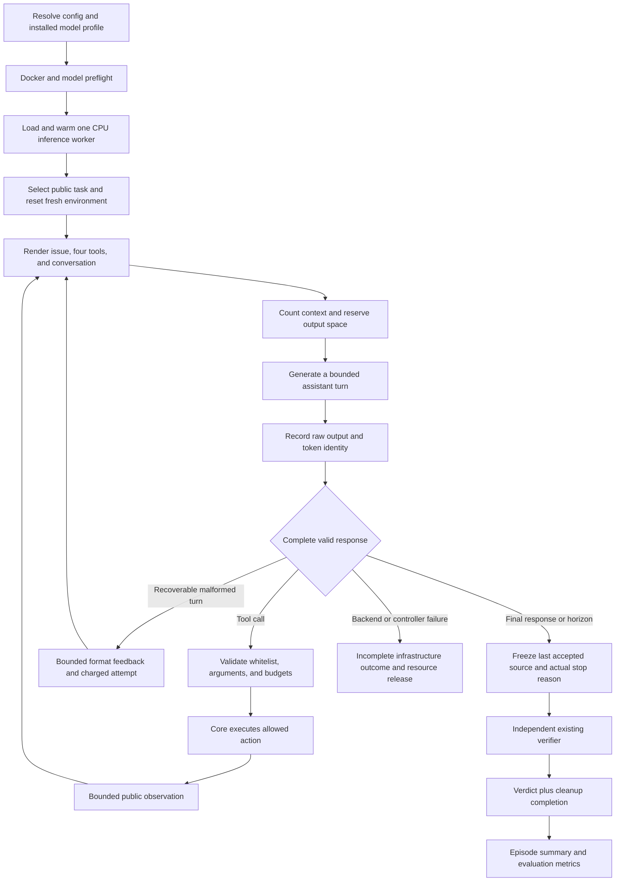

# Phase 2 design: real CPU coding-agent rollouts and evaluation

Design date: **2026-10-14**. Phase 2 corresponds to Stage B in the original plan. This document specifies future implementation only. No inference packages, model weights, Python implementation, or configuration changes were added in this design pass.

Implementation follow-up, **2026-10-15**: the design below is preserved as proposed. See [Phase 2 status](PHASE_2_STATUS.md) for the implemented CPU profile, executed validation, and remaining real rollout/evaluation gates.

Read [the Phase 1 evaluation](PHASE_1_EVALUATION.md) first. Its cleanup/cache finding is the first prerequisite.

## 1. Goal and mental model

Replace the authored decision sequence with real model-generated decisions while preserving the existing environment and trusted verifier.

The model receives an issue and tool descriptions. It chooses to inspect files, propose edits, and run visible tests. The harness validates each decision and presents the resulting observations. When the attempt ends, the existing verifier judges the actual accepted source changes.

Phase 2 succeeds when a genuine CPU model attempt has a reproducible identity, recorded generations, validated actions, bounded execution, independently judged source, and a useful evaluation summary. An incorrect attempt can demonstrate correct integration. A passing scripted repair cannot establish model success.

| Phase | New capability |
|---|---|
| Phase 1 | Deterministic environment lesson and executable binary reward |
| Phase 2 | Real Transformers inference, manual coding harness, held-out baseline |
| Phase 3 | Native TRL GRPO sampling and genuine policy updates |
| Phase 4 | Optional custom harness and CPU vLLM evaluation |

CPU Transformers is the required first inference profile. Additional CUDA or vLLM profiles need separate dependency/hardware gates. Phase 2 creates no optimizer and does not treat its trajectories as native GRPO batches.

## 2. End-to-end flow

Load/warm the model before resetting an episode. Otherwise model startup consumes the current environment's task deadline and can make the first attempt time out before it acts.

Every new attempt has a fresh environment and conversation. The inference worker may retain weights between episodes; it must not retain conversation/recurrent state between requests. Re-render the complete conversation each turn initially. Avoid incremental cache reuse until its correctness is tested.

## 3. Smallest useful ownership model

| Owner | Responsibility | Data it receives |
|---|---|---|
| Controller / manual harness | Episode lifecycle, public conversation, parser, dispatch, counters, finalization | Public task fields, tool schemas, model outputs, tool observations |
| Inference worker | Load one checkpoint and generate token continuations | Rendered public input IDs/masks and whitelisted sampling settings |
| Existing environment | Repository state and accepted effects | Validated tool names and arguments |
| Existing Docker execution worker | Execute visible tests or private case calls | Read-only candidate snapshot and the applicable public execution inputs |
| Existing private controller | Compare actual outputs to protected cases | Frozen candidate and protected grading plan |
| Evaluator | Select held-out attempts and aggregate honest results | Completed episode outcomes and infrastructure records |

Keep the inference worker separate from candidate-execution containers. Model libraries and cache are trusted inference dependencies, not tools available to submitted Python. Never mount the model cache or task grading catalog into candidate containers.

A single persistent local inference process provides a hard cancellation boundary without adding a server. The controller loads the tokenizer for rendering/counting; the child owns model weights. Start the child through a clean spawn mechanism, load weights only there, and exchange bounded primitive request/result records. Do not copy a loaded model through multiprocessing or load a second model in the parent.

A generation request has an ID, input token IDs, attention mask, bounded generation settings, and deadline. Its response has the same ID, generated token IDs, stop information, and timing. The child receives no private cases, reference patches, host workspace path, or tool execution capability. This is a trusted inference component, not a sandbox for arbitrary checkpoint-provided Python.

Initialize the runtime's supported random state from a recorded request seed derived from base seed, task, attempt, and turn. Use a stable derivation rather than Python's randomized object hash. Seeding supports repeatability within the tested profile; it does not guarantee identical output across different hardware or library versions.

For a hard generation timeout, terminate and join the inference worker, discard late responses, and grade only the last accepted source. Reload before another attempt and report that reload separately. A token-level stopping hook is useful for ordinary stops but cannot reliably interrupt a long model operation before its next callback.

## 4. Changes to existing files and minimal new files

| File | Intended work |
|---|---|
| `src/environments/coding.py` | Fix pending cleanup on cached verdicts; expand stop reasons; classify trusted I/O failures without changing tools |
| `src/config.py` | Add optional model, rollout, and evaluation records; preserve valid Phase 1 configurations |
| `src/utils/trace.py` | Explicit policy identity, generation/parse events, counters, failure/completion distinctions, schema versioning |
| `src/harnesses/scripted.py` | Retain the scripted lesson; add a distinct model episode runner using public data only |
| `src/main.py` | Add rollout/evaluation interfaces and clear preflight/dependency diagnostics |
| `src/tasks/catalog.py` / `src/environments/verifier.py` | Expose a public task projection and record a grading-plan fingerprint |
| New `src/models/backend.py` | One tested Transformers loading/generation backend and inference-worker ownership |
| New `src/models/worker.py` | Trusted child process entry and bounded generation request loop |
| New `src/harnesses/protocol.py` | Schema conversion, checkpoint-specific parsing, typed validation, fixed dispatch |
| New `src/coding_rl/rollout/evaluate.py` | Held-out attempt scheduling, per-task summaries, and metrics |

Combine a new file when it would otherwise contain only a trivial wrapper. Use ordinary functions and typed records. A model abstraction becomes a protocol only when an actual alternate backend needs it; vLLM and external-agent infrastructure are deferred.

The current importable `run_episode` is reference-driven. Preserve that behavior for the teaching commands and expose a separately named model operation. The CLI's real rollout path must never call `Task.variant`, read `references`, or choose an oracle patch.

For B0, store a completed verifier verdict independently of episode completion. The verification event may record known correctness before cleanup; publish the usable reward event and completed result only after resource release succeeds. A cached request first retries pending cleanup, then publishes at most once using a small publication flag. It never reruns successful private tests or changes a correct verdict into reward zero because cleanup failed.

## 5. Dependency and uv plan

Add a `rollout` optional dependency extra for the tested PyTorch and Transformers pair. Declare any model download/tokenization packages imported directly, even if another dependency also supplies them. Add Accelerate only if the chosen loading route actually needs it. A text-only route should not automatically pull in a full vision application stack.

Base installation, environment demos, tests, and Docker workers remain lightweight. Model imports happen only when a model operation is requested; importing `coding_rl` or running `env-demo` must still work without the rollout extra.

uv supports optional dependencies and selecting package sources through project metadata. Keep the extra and its source selection in `pyproject.toml`, then update the single lock after compatibility checks. [uv dependency management](https://docs.astral.sh/uv/concepts/projects/dependencies/)

For the tested CPU platform, select PyTorch's CPU wheels through an explicit index and appropriate platform/extra markers. This avoids silently installing a CUDA build for a CPU profile. Do not pretend that a CPU-only wheel becomes a CUDA backend when the device setting changes. [uv's PyTorch integration guide](https://docs.astral.sh/uv/guides/integration/pytorch/)

Future packaging checks must exercise both base installation and the rollout extra. Docker's existing no-extra installation must continue to install only execution dependencies. Verify that uv can resolve the complete dependency graph while the runtime worker still stays small.

Exact inference versions are **pending**, because no target model probe has run. Prefer mutually compatible releases; if unreleased behavior is necessary, record an exact reviewed commit and its limitation. Reconfirm Python support for the selected extra instead of assuming the base package floor certifies every inference dependency.

## 6. Model compatibility gate

Preserve **`Qwen/Qwen3.5-0.8B`** as the target. Resolve its immutable checkpoint revision and tokenizer/template revision before a measured run. Use text-only prompts and start with non-thinking behavior, verified through the actual template settings.

The official card identifies a language model with a vision encoder and warns that this size can loop in thinking mode. Those are reasons to verify the loading/template path, not evidence of CPU throughput or working tool calls in this repository. [Target model card](https://huggingface.co/Qwen/Qwen3.5-0.8B)

Transformers documents `Qwen3_5ForCausalLM` with a text configuration and a slower PyTorch fallback when optional DeltaNet kernels are absent. Validate this exact checkpoint's text-weight mapping; do not assume a generic loader correctly removes vision weights. [Qwen3.5 loading guidance](https://huggingface.co/docs/transformers/model_doc/qwen3_5#usage-tips-and-notes)

| Probe | Passing evidence |
|---|---|
| Architecture availability | Selected installed release has the required config/model classes |
| Weight loading | All required language weights load; missing/unexpected keys are understood; no random text head |
| Tokenizer/template | Matching revision, supported tools, correct assistant prefix and non-thinking mode |
| CPU forward/generation | Finite short output on the selected dtype without required GPU-only kernels |
| Tool protocol | Actual model-generated read call parses and executes; later probes cover multiline patch calls |
| Episode isolation | Repeated independent requests do not retain another task's model cache/history |
| Inference-only behavior | Evaluation/inference mode; no optimizer or weight-update path |

Use FP32 as the initial CPU correctness baseline. Try BF16 or another supported mode only after device/operation checks and measurements. Loading the documented full conditional-generation class is a possible explicit fallback if the text route fails, with its actual memory footprint reported. An alternate small checkpoint is an explicit diagnostic profile, never a silent substitution for the requested target.

Start with one sequence per request and no packing. Qwen3.5's linear-attention boundaries need additional correctness checks when samples are packed; Phase 2 avoids that complexity and resets each request's generation cache. [Transformers sequence-boundary guidance](https://huggingface.co/docs/transformers/en/padding_free)

## 7. Public prompts and the exact tool protocol

Build the conversation from a concise system instruction, the task's public issue, and four named function definitions. Explain the restricted patch format explicitly: existing source files, exact unified diff headers/contexts, no Git preamble or alternate patch language.

Do not serialize a full `Task`, inject reference repairs, append hidden results, or include developer inspection output. Source and visible test outputs are external observations; any instructions found in them remain data and cannot widen the dispatch whitelist.

The current inspection schema maps names to descriptions/parameter schemas. Convert it into the function envelopes expected by the actual tokenizer template, including each function name. Match required fields and defaults to the core methods. The official tool guide describes functions/schema inputs, assistant tool-call messages, and serialized tool-role results. [Transformers tool-use guide](https://huggingface.co/docs/transformers/en/chat_extras)

Prefer the installed library's response parser when the tokenizer provides a matching response template. Supply the actual generation prefix: parsing a completion without its prefilled prefix can misinterpret the turn. Availability is checkpoint-specific, not guaranteed by importing Transformers. [Transformers response parsing](https://huggingface.co/docs/transformers/en/chat_response_parsing)

If unavailable, either implement one bounded parser for the observed checkpoint protocol or fail the gate clearly. A fallback parser must be tested against the real template; do not infer calls from arbitrary prose, execute expressions, or strip delimiters before saving raw output.

| Response | Controller treatment |
|---|---|
| Complete recognized tool call | Normalize the supported envelope, validate types/keys/name/budgets, then dispatch |
| Complete final response without tool intent | Finish and judge actual accepted source |
| Unknown tool or invalid typed arguments | Return bounded error feedback; charge a proposed-call attempt; no side effect |
| Incomplete/invalid tool region | Record a parser error; bounded recovery while attempts remain |
| Generation truncated by a token/context/time horizon | Execute no new action from that turn; freeze the last accepted source |

The starting profile accepts **one tool call per assistant turn**. This is a deliberate simplification of the earlier broad draft. A multi-call proposal is recorded and rejected without executing a partial subset; identified proposals consume the remaining attempt budget according to the documented counter policy. Serial multi-call support can follow after the single-call loop is proved.

Use a fixed mapping of the four names to their methods. Validate missing/unexpected arguments, exact integer versus boolean types, string/file/patch size, and JSON value bounds before invocation. Core path/patch checks remain authoritative.

Preserve raw and parser-normalized arguments where a supported parser performs typing. Validate that boolean coercion cannot bypass integer bounds. Do not add extra ad hoc coercions.

Every recognized call gets a paired public result using the template's supported name/call-ID convention. Malformed text has no trustworthy call ID; use a defined harness-feedback message appropriate to that template, rather than inventing a dispatchable call. Retain the raw generation separately for diagnosis.

## 8. Model episode, step by step

1. Validate the selected CPU dependency profile, checkpoint identity, Docker backend, and model/template compatibility.
2. Load and warm the inference worker once under a separate startup deadline. Record startup costs outside episode timing.
3. Select a task and seed. Reset fresh state and create a fresh conversation from public fields.
4. Render with the actual tools/template. Count the complete input, including schema/delimiter overhead. Reserve space for generation and at least a compact tool/error observation.
5. Generate using the smaller of per-turn and remaining episode token budgets. A parent deadline bounds the entire request, including prefill.
6. Record original completion IDs/text and stop information before parsing. Parse only fully completed turns for new tool execution.
7. Validate the whole proposed single-call envelope, charge dispatcher budgets, append its assistant representation, and invoke only the allowed method.
8. Serialize a bounded observation while preserving required fields and a truncation flag. Keep valid result envelopes; do not cut JSON in the middle. Append the actual shown result and continue.
9. On final response or a healthy horizon, record the reason, freeze accepted source, and call the existing independent verifier once. Never apply a partially generated patch.
10. Complete cleanup and emit a model episode result. A verifier/host/inference infrastructure failure produces a separately recorded incomplete outcome with no usable reward.

Reserve observation space before executing a side-effecting tool. Accepted actions and their shown results must remain in the recorded conversation. If the next action/result cannot fit, stop before mutating state. Do not delete earlier accepted action history to create space.

For a correctly verified artifact at a horizon, keep reward 1.0 and its limit reason. Parser failures or unsuccessful visible tests receive no separate shaping penalty; terminal correctness still judges the last valid source. A backend crash is an infrastructure outcome, not the same as a normal budget stop.

## 9. Configuration and budget ownership

Add a CPU rollout profile while retaining the Phase 1 defaults. Proposed values below are pilot settings, not measured defaults.

| Setting | Initial proposal | Owner |
|---|---|---|
| Model / device / dtype | Target checkpoint, CPU, FP32 | Model backend |
| Backend | Transformers | Controller/backend |
| Concurrent sequences | One | Worker and scheduler |
| Tool attempts | Six, including rejected proposals | Dispatcher; core also caps entered calls |
| Assistant turns | Eight, counting final and malformed responses | Harness |
| Parser recovery limit | Two consecutive malformed protocol turns; reset after a valid protocol parse | Harness |
| Accepted calls per turn | One | Protocol validator |
| Generated tokens per turn | 256 | Generation request |
| Generated tokens per episode | 768, including generated delimiters/reasoning | Harness |
| Total context | 2,048 initially; explicit larger profile only if template probe requires it | Tokenizer-aware controller |
| Observation tokens | 256, including necessary result metadata | Presentation adapter |
| Generation wall time | 90 seconds initially, bounded by remaining episode time | Parent worker supervisor |
| Episode wall time | 300 seconds initially; excludes model startup | Harness plus core profile |
| Command wall time | Existing 20 seconds | Docker supervisor |
| Verification wall time | Existing 120 seconds, independent of rollout | Verifier owner |

Also require checkpoint/tokenizer revisions, cache policy, offline mode after preparation, sampling mode/settings, attempts per evaluation task, seeds, selected split, report path, and calibrated model-startup deadline.

Keep three distinct call counts: proposed attempts, entered core methods, and accepted effects. A malformed turn with no identifiable call charges one recovery attempt. A well-formed unknown or wrongly typed call charges one proposed attempt. The total cannot grow indefinitely while core calls stay at zero.

Stop reasons should distinguish final response, tool limit, turn limit, token limit, context limit, episode timeout, generation timeout, parser limit, cancellation, and infrastructure failure. Run completion and verifier verdict are separate fields.

Admission checks reject real model mode with `trusted_local`, missing inference dependencies, unsupported device/dtype combinations, incompatible parser/template, and an initial prompt that cannot fit required reserves. Model setup and worker limits are separate; the Docker command timeout is not the model-generation timeout.

## 10. Trace and outcome contract

Version the expanded trace schema. Phase 1 scripted records keep their truthful scripted identity; model records identify the actual checkpoint, resolved revision, tokenizer/template fingerprint, dependency profile, dtype/device, sampling settings, and seed.

New generation records need turn/request identity, input/completion token counts, original generated IDs or an exact artifact reference, raw text with special-token preservation, parsed representation, stop information, and generation timings. Preserve full bounded raw generations in artifacts when terminal display is shortened.

Record proposed and accepted call counters, parser diagnostics, exact model-visible observations, source hashes after accepted edits, final response, termination, independent verdict, and cleanup status. Add a private-safe fingerprint of the grading plan, not its expected answers.

The model outcome should hold task/episode IDs, driver kind, policy identity, seed, finish reason, verdict/reward or infrastructure status, source hashes, call/turn/token counts, timings, and artifact references. The authored `variant` field belongs only to scripted runs.

Phase 2 token IDs support debugging and faithful rollout accounting. They do not establish behavior log probabilities, action masks, weight synchronization, or a native GRPO loss batch. Phase 3 keeps those through TRL's supported mechanism.

## 11. Held-out evaluation and CPU pilot

Use the three training-partition tasks for parser/prompt development. Keep the chunk-tail family held out for the initial reported baseline. Do not choose prompts or budgets by repeatedly maximizing that held-out task's score.

Begin with one greedy development attempt to inspect the protocol. Then declare a fixed sampled baseline, for example four attempts per held-out task with separate recorded seeds. Temperature/top-p are profile choices to benchmark, not claims of optimal sampling. Greedy repeats do not become independent evidence merely by changing seeds.

For each attempt: fresh environment, fresh conversation/cache, the same immutable checkpoint, identical declared tools/limits, and independent grading. Count a verified failure or healthy horizon in the denominator. Report infrastructure exclusions and coverage explicitly; retries must not cherry-pick better model outputs.

| Report field | Meaning |
|---|---|
| Verified pass rate / mean binary reward | Successes over valid evaluated attempts |
| Attempt coverage | Planned, started, valid, incomplete, and retried attempts |
| Per-task verdicts | Correct/incorrect/protocol/resource categories |
| Parser and action diagnostics | Malformed turns, rejected calls, entered calls, accepted edits |
| Horizon reasons | Actual final/limit reasons, including limited-but-correct attempts |
| Tokens and time | Prefill/decode where measured, episode generation, tool execution, grading, cleanup |
| Resource measurements | Model load time, first-token latency where instrumented, decode rate, peak resident memory |
| Reproducibility | Protocol/config/model/template/grading fingerprints, package versions, hardware |

A zero pass rate can still be an honest baseline. Do not inject a reference solution to obtain a positive result. One held-out family measures the evaluation plumbing; it does not support a broad coding benchmark claim.

Measure actual complete-episode costs before promising a longer CPU run. The nominal language weights alone are roughly 3.2 GB in FP32 by parameter-count arithmetic; full checkpoint, cache, activations, logits, and process overhead add more. Record measured memory and time rather than calling 0.8B automatically fast on CPU.

## 12. Ordered implementation milestones

| Order | Work | Completion evidence |
|---|---|---|
| B0 | Resolve Phase 1 cleanup/cache and infrastructure reporting gaps | Fault-injected cleanup retry; stable verdict; no live completed episode; existing suite preserved |
| B1 | Define strict optional config, identity, and expanded outcomes/traces | Old Phase 1 configs/commands work; model identities cannot be labeled scripted |
| B2 | Resolve rollout extra and CPU wheel source; prepare checkpoint | Base and extra packaging pass; immutable revisions and exact versions recorded |
| B3 | Prove target text loading, template rendering, prefix-aware parsing, and CPU generation | Genuine read call plus loading/parser report; no oracle data in inputs |
| B4 | Implement bounded protocol/dispatcher and persistent inference worker | Fake backend exercises malformed/truncated turns, deadlines, counters, and cancellation |
| B5 | Connect a genuine model episode | Actual generated read/edit/test flow, recorded observations, frozen source, trusted verdict |
| B6 | Add rollout/evaluation CLI and held-out scheduling | Per-attempt results, truthful denominator, no reference repairs in model path |
| B7 | Run CPU pilot and publish baseline | Measured target profile, held-out metrics, explicit failures/limits, reproducible artifacts |

Planned CLI names remain `rollout` and `eval`; they are not implemented by this design. Their implementation should use the same configuration entry point and the optional rollout extra, with dependency guidance when that extra is absent.

## 13. Acceptance checks for the coding phase

Keep most new tests model-free with a fake token-generation backend. Fake outputs may use authored test repairs to exercise plumbing, but must never be labeled real model evaluation.

| Check | Required behavior |
|---|---|
| Base regression | All Phase 1 tests and commands continue to work without model packages |
| Cleanup completion | A cached verdict cannot bypass pending resource cleanup |
| Public projection | Private cases, references, host paths, and debug inspection never enter model requests |
| Schema/protocol | Exact four tools, valid template envelopes, real prefix passed to supported parser |
| Dispatcher | Unknown names, missing/extra fields, wrong types, multi-call proposals, and large arguments have bounded no-effect errors |
| Budget accounting | Rejected/unknown calls consume attempts; observations count toward context; partial turns cause no new effects |
| Generation cancellation | Long prefill/decode is interrupted through worker ownership; no late response is accepted |
| Side-effect history | No committed action is lost by truncating or rewriting its conversation record |
| Model isolation | Fresh conversation/recurrent cache per request/episode; model weights stay in inference mode |
| Real integration | Target model emits and executes genuine tools; a model-generated source edit is captured and graded |
| Honest metrics | Candidate failures/horizons count; infrastructure outages have explicit exclusions; scripted attempts cannot enter baseline |
| Packaging | Built wheel works with base and extra profiles; candidate Docker image contains no model/grader assets |

A solved target-model task is useful extra evidence, but not a substitute for these mechanics. If the model cannot produce valid tool edits, mark that gate incomplete and report whether loading, parsing, task difficulty, or budgets caused the limitation.

## 14. Completion and handoff to Phase 3

Phase 2 is complete when the target CPU profile is tested and pinned, a real model can operate the unchanged four-tool environment, final accepted source is independently verified, held-out results and resource costs are recorded, and all ownership/failure checks pass.

The Phase 3 handoff contains the verified model/template/parser profile, environment and verifier identities, representative real trajectories, parser/error statistics, baseline metrics, and measured budgets. Native TRL integration still needs its own same-task grouping, mask/probability, truncation, and changed-weight checks.

No inference compatibility or throughput claim is certified by this document. All listed model probes remain implementation-time gates.
