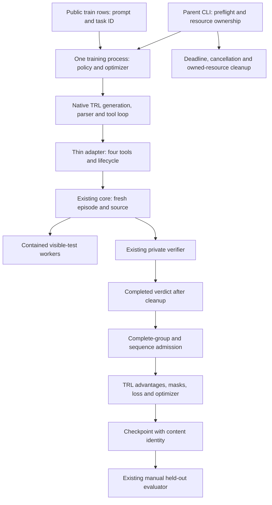

# Phase 3 design: native TRL training and verified policy updates

Design date: **2026-10-15**. This is an implementation plan, not a training result. No TRL dependency, adapter, optimizer, training command, or checkpoint loader is added by this document. Phase 3 is Stage C of the [implementation plan](06_STEP_BY_STEP_IMPLEMENTATION.md).

The next delivery closes the remaining Phase 2 integration gates, then demonstrates that independently verified coding rewards can change the actual policy through native TRL. Preserve the existing environment and manual evaluator. Build one working training profile before extending it to a second parameter-update mode or device.

## 1. Starting point and remaining prerequisites

| Area | Recorded current state | Next work |
|---|---|---|
| Environment and verifier | Four bounded tools, immutable starters, independent grading, cleanup/cache correction | Reuse; add native ownership/correlation only where required |
| CPU inference | Pinned Qwen3.5 text loader, non-thinking XML protocol, genuine generated source read | Run a real read/edit/test episode through Docker |
| Manual harness | Bounded generation and dispatch, schema-v2 traces, fake-backend failure tests | Preserve as rollout/evaluation owner |
| Held-out evaluation | Scheduler and metrics implemented | Publish a fixed pre-training baseline with actual coverage |
| Native training | No TRL adapter or training dependencies | Establish installed API, tensor, failure, and optimizer contracts |
| Checkpoint evaluation | Backend loads a pinned Hub snapshot; no explicit trained-artifact contract | Add full/LoRA artifact identity and reload support |

[Phase 2 status](PHASE_2_STATUS.md) records 112 passing tests and eight skipped Docker checks from its validation run. Its [real CPU read diagnostic](evidence/phase2-cpu-read.json) used 687 input tokens, generated 26 tokens in 140.80 seconds, and peaked at 4,961,746,944 RSS bytes. These are recorded single-request inference measurements; they establish neither training feasibility nor a held-out score. No tests are rerun merely to write this design.

**Prerequisite B-close:** on a Docker-capable host, build the existing worker, run its effective-limit checks and Docker tests, then run an authentic development episode. Capture actual model calls, at least one proposed edit, visible feedback, frozen source, a trusted verdict, and cleanup. A valid unsuccessful attempt is acceptable integration evidence. Never supply a reference repair to make this gate pass.

Declare an evaluation profile before sampling the held-out `chunk-tail` family. Keep checkpoint/tokenizer revisions, sampling, seeds, context/tool limits, image identity, and grading fingerprints fixed. Four sampled attempts per held-out task are an initial small baseline, not a general coding benchmark. Save all planned/started/valid/incomplete counts. A zero valid denominator yields no pass rate. Use the three training tasks for prompt and budget development.

Adapter/unit-test development may proceed while Docker is unavailable. Native runtime acceptance and a comparable before/after claim require B-close. If the native training template/device differs from the manual evaluator, keep that distinction in the run manifest; evaluate both policies with the same declared evaluation profile.

## 2. Ownership and data flow

TRL owns training-time generation, parsing, observation insertion, behavior/current probabilities, grouping, and the learning sequence. The adapter delegates file and verification semantics to the core. A small run owner tracks episode/group identities, failures, and cleanup. It must not become another agent framework or implement GRPO itself.

Do not call `run_model_episode`, `harness.run_episode`, or the persistent inference worker from inside the native training loop. The current inference child disables gradients and owns a separate fixed policy. JSONL generations are diagnostic artifacts, not a native training batch.

Start with one training process, one device, no packing, no vLLM, and no asynchronous rollout/training overlap. Every complete group uses one policy version. After a committed update, new rollouts use the updated model; cached pre-update completions cannot silently enter the next collection.

## 3. Dependency and hardware gate

Retain the base installation and the tested `rollout` extra. Resolve optional `train-cpu` and, only when tested hardware exists, `train-cuda` profiles. Training adds TRL, Datasets, Accelerate, and required direct imports to a compatible Torch/Transformers pair; PEFT belongs to the LoRA profile. Exact versions are pending an installed compatibility probe. Do not label the current inference pins as a tested training stack.

Prefer one uv lock. Keep Linux CPU Torch on its explicit CPU index. A CUDA profile must select a matching CUDA wheel/index and cannot be created by changing `device` on a CPU-only installation. Declare incompatible extras, including CPU rollout plus a conflicting CUDA training source, and test rejection. If no unified graph can preserve the working rollout stack, document the actual conflict and isolate training in a separately locked profile rather than silently changing the CPU environment.

Record Python/platform, package versions and source revisions, native constructor/config signatures, model class/loading report, available device operations, RAM/VRAM, and forward/backward costs. Moving upstream documentation is evidence to investigate, not an installed dependency certificate.

Use FP32 for the first correctness probe. CPU full training remains an explicit experiment. At 0.8B parameters, FP32 weights, gradients, and two FP32 Adam moments alone are about 12.8 GB by arithmetic, before activations, logits, temporary copies, and process overhead. Measure actual peak use before admitting a run. CUDA and lower-precision profiles need their own forward/backward, masking, and reload gates. Never promise training latency from the recorded CPU inference request.

## 4. Native adapter and public dataset

Create `trl_env.py` with a no-argument factory closing over validated configuration, the catalog, and the trusted run owner. Every produced adapter owns one core; resets allocate new episode IDs/workspaces even if TRL reuses an adapter object.

| Adapter member | Contract |
|---|---|
| `reset(task_id, **metadata)` | Resolve only permitted train tasks, validate public identity, reset the core, register the episode, and return `None` in dataset mode |
| `get_reward()` | Freeze accepted source, obtain the core's completed reward after cleanup, and associate it with the right attempt |
| `list_files`, `read_file`, `apply_patch`, `run_tests` | Typed, documented methods with the existing argument/default/schema semantics |
| Private state/helpers | Core, recorder, failure state, group identity, and cleanup; never discoverable as model tools |

The native factory/dataset lifecycle is documented upstream, including reserved lifecycle methods and dataset metadata forwarding. Confirm it in the selected installed release before coding around it. [Official native environment contract](https://huggingface.co/docs/trl/en/grpo_trainer#environments)

Use training-only public rows. The existing `TaskCatalog.dataset_rows()` has issue text and task IDs; the manual harness additionally supplies system instructions and editable paths. Build native rows from the same public projection so instructions about the four tools and restricted patches are present once. Never serialize a full `Task`, private cases, reference variants, host paths, or inspection output. Reject held-out task IDs at the training adapter boundary.

Keep dispatch validation independent of the manual loop so the adapter can reuse exact type/size rules and bounded JSON observation presentation. A native parser may normalize arguments before invocation; verify that booleans cannot become valid line integers through coercion. Compare the entire discovered callable/schema set against the four-tool allowlist, including no-argument tools. Do not expose public `close`, `inspect`, or audit methods to simplify ownership.

## 5. Templates, tokens, and limits

Verify the selected native response parser against genuine Qwen3.5 read and multiline-patch generations. The manual XML fallback proves the manual profile only. Record parser identity, original and native training-template hashes, and the actual generation prefix. Native Qwen training templates can differ from the inference template; prefix preservation must be tested on the installed selection. [Official training-template guide](https://huggingface.co/docs/trl/en/chat_templates#qwen3_5_think_trainingjinja--qwen3_5_nothink_trainingjinja)

Preserve non-thinking behavior and the tested tokenizer EOS/pad IDs (`248046` / `248044` for the current snapshot). Test tool-call endings and complete final responses instead of trusting the checkpoint text config's EOS. Compare token prefixes before/after tool feedback, including malformed-response recovery and multiline parameters.

Treat these as distinct proposed owners, not interchangeable counters:

| Limit | Native design |
|---|---|
| Entered core calls | Existing cap of six, including rejected calls that reach the core |
| Proposed/unknown/malformed calls | Count through a verified native dispatch/export point; otherwise explicitly report this counter as unavailable |
| Tool iterations | Explicit native turn limit; does not itself enforce six proposed calls |
| Calls per turn | Preserve the single-call policy only if native dispatch can enforce it before effects; otherwise fail that profile's admission or explicitly design/test different semantics |
| Completion tokens | Native completion-region budget, with actual inclusion of tool suffixes verified in the installed implementation |
| Context/observations | Count the actual template and preserve accepted action/result history; bound feedback before insertion |
| Wall time | Parent supervision for native generation/training, plus existing candidate and grading deadlines |

Phase 2's `max_new_tokens`, `episode_tokens`, `parser_recovery_limit`, and generation timeout are manual-harness settings. Do not silently map all of them to one TRL field or imply they are enforced during training. Produce a configuration translation table naming each supported native setting and reject requested guarantees without a valid implementation point.

**Boundary acceptance:** put an accepted `apply_patch` immediately before a tool-result/context cutoff. Compare executed effects and their public observations against the exact trainer-held IDs and masks. Also test a partial generated patch and a multi-call proposal. If a call/result is removed after its side effect commits, that trajectory is ineligible. Truncation loss masking alone does not repair a state/history disagreement.

The reviewed upstream tool loop executes tools before deciding whether appended results exceed its token/context limits. This is a source-based risk to reproduce, not a demonstrated defect in an installed project dependency. Resolve it through a supported admission/dispatch mechanism or a reviewed compatible upstream version/commit. Do not ship a private-method monkeypatch as supported native integration. [Reviewed tool-loop source](https://github.com/huggingface/trl/blob/main/trl/trainer/grpo_trainer.py)

## 6. Group and tensor admission before an update

Begin with one task per group and four independent attempts. Maintain an explicit mapping between collection ID, policy version, task/starter/grading identity, native completion position, episode ID, and reward. Task ID alone is insufficient when the same task appears in successive groups.

Require all four members to resolve the same task/starter, verifier plan, tools, and policy version, while owning separate workspaces and random streams. Verify ordering through native sampling and gradient accumulation, rather than assuming four consecutive reset calls are the complete group.

Inspect the tensors TRL actually uses:

- Original prompt/completion IDs and final source identity align with the accepted tool sequence.
- Generated call/text positions carry the applicable policy-loss mask; prompt, tool observations, padding, and excluded truncated positions do not.
- Behavior/current probabilities, and reference probabilities if enabled, refer to the same conditioning and selected token positions.
- Non-padding positions are valid; masks are nonempty where learning is claimed; probabilities/loss/gradients are finite.
- Independent versus padded execution agrees within declared dtype tolerances, and Qwen3.5 recurrent/cache state does not cross samples or episodes.

Use a supported native export/extension point for audits. Re-tokenizing the JSON conversation, overriding a private collection method, or merely inspecting an SFT assistant mask cannot establish the GRPO tensor contract. If exact admission/audit cannot be implemented against the selected release, mark this gate unresolved and prevent a claimed training proof.

## 7. Infrastructure failure, cancellation, and resource ownership

The reviewed native loop catches ordinary tool exceptions and can show them as tool results. Therefore raising `InfrastructureError` from `run_tests` is insufficient by itself to guarantee group rejection. [Reviewed exception-handling source](https://github.com/huggingface/trl/blob/main/trl/trainer/grpo_trainer.py)

Latch infrastructure failures in trusted per-attempt state before propagating them. A later successful grade must not rehabilitate an infrastructure-corrupted collection. Verify that the selected native integration stops the affected complete group before advantages/backward/optimizer admission. Include a final check before any optimizer mutation. If supported hooks cannot provide those guarantees, fail the compatibility gate instead of substituting zero or continuing a partial group.

Retry grading infrastructure against the same frozen source under the existing bounded policy. Do not regenerate only the failed member or discard a single reward from a group. Known correctness with failed cleanup remains incomplete; cleanup failure never changes a correct verdict to zero.

For hard native deadlines, the parent owns a supervised training process rather than trying to interrupt a long tensor operation through the next tool entry. Unlike the Phase 2 inference child, terminating this process also terminates its optimizer/model state; preserve only the last completely committed checkpoint.

Before enabling hard termination, extend ownership so the parent can release exact run-owned Docker workers and temporary roots even when the child cannot run `finally`. Register resource identities before launch, use a run-specific container label/name, and keep owned workspaces/snapshots under an explicit private root. Cleanup must never sweep unrelated containers or arbitrary paths. Keep host resource paths outside model messages and ordinary public trajectories.

Test graceful interruption and forced termination during generation, visible tests, private grading, and checkpoint save. No surviving candidate worker, writable episode root, partial usable checkpoint, or apparently completed update may remain. Until this ownership path passes, do not advertise hard native wall-time support.

## 8. First informative GRPO update

The following is a pilot configuration to validate in C1, not an executable YAML profile today:

| Setting | Proposed initial value/reason |
|---|---|
| Group size | Four attempts for the same train task |
| Generation/effective batch | Four samples; one device, microbatch one, four accumulation steps; verify the resolved native layout |
| Generation batch control | Select `generation_batch_size` or `steps_per_generation`, not both |
| Updates per collection | One; collect a new group from the updated policy afterward |
| Loss/scaling | Explicit `grpo` and group reward scaling, subject to installed support |
| Optimizer | AdamW, learning rate `1e-6`, weight decay `0.0` for the first proof |
| KL coefficient | Explicit `0.0`; reference-model behavior is a separate later gate |
| Sampling | Sampled, non-thinking; declare temperature/top-p and seed mapping before collection |
| Packing/quantization | Disabled |
| Precision/device | One measured supported profile; CPU FP32 is experimental |

The exact batch argument relationships must be checked against the selected configuration implementation. [Official GRPO configuration source](https://github.com/huggingface/trl/blob/main/trl/trainer/grpo_config.py)

Use a finite training-only feasibility pilot, initially at most eight complete groups before reviewing cost and reward variance. Record all groups and stop reasons. An informative group contains both independently verified rewards zero and one from genuine policy attempts. Fake/scripted groups validate plumbing only. Easier public training tasks, larger verified budgets, or an explicit alternate model are legitimate new profiles; changed settings require a new recorded pilot and compatible baseline.

Equal-reward or fully masked groups do not establish task learning. Do not rescore them, retain only successful members, or repeatedly run until an unreported lucky trace appears. Handle zero-contribution groups using supported native behavior and report their rate. An absent informative group is an incomplete training gate, not permission to fabricate variance.

For an admitted informative group, record finite nonzero task-reward gradients, optimizer/global step, intended trainable parameter names/counts, and before/after numerical changes above declared tolerances. Disable unreported auxiliary rewards and decay for this proof so weight movement alone cannot masquerade as learning from correctness. Fingerprint frozen parameters and verify they stay unchanged where applicable. Budget any diagnostic tensor copies into the memory probe.

After the first accepted update, a second collection or explicit native generation must demonstrate use of the updated policy. A changed file, checkpoint directory, or step counter alone does not establish an optimizer-to-generation connection.

## 9. Full and LoRA checkpoints and evaluation

Implement one mode end to end first, normally full training when the measured host can support it. LoRA may be the first certified mode if full training exceeds the host budget; record the choice. Each mode must independently pass grouping, masks, parameter-change, save/reload, and evaluation gates. Phase 3's complete full/LoRA deliverable is not established by one mode's result.

For LoRA, inspect actual target module names and record the resolved list, rank/scaling/dropout, trainable count, and frozen base identity. Reject an empty or unexpectedly broad match. Verify native generation sees the active adapter. Do not add quantization, compilation, or a second sampler to this first LoRA proof. PEFT saves adapter artifacts with a base-model dependency; reloading must reconstruct that exact pair. [Official PEFT checkpoint format](https://huggingface.co/docs/peft/en/developer_guides/checkpoint)

Introduce explicit policy source records: pinned Hub snapshot, local full checkpoint, or local LoRA checkpoint. Preserve existing Hub configurations. Local identity comes from a checked file manifest/content digest, not a made-up Hub revision. A LoRA identity includes both base commit and adapter digest.

Save checkpoint kind, parent/base identity, source-code/config/dependency fingerprints, training/global step, tokenizer/EOS settings, native template hash, task/verifier/image identities, weight-file digests, and completed update evidence. Write a temporary checkpoint and publish its completion manifest only after files are closed, verified, and reloadable. Interrupted saves remain unusable. Resume, if exposed, must validate optimizer/scheduler/random state and collect fresh rollouts under the restored policy; it is distinct from loading weights for evaluation.

Extend `models.py` and the inference-worker loading path so `eval` can load both trained artifact kinds offline and in inference mode. Compare deterministic reload outputs/logits against the saved policy within a declared tolerance. Keep the fixed evaluation tokenizer/template and sampling profile for both baseline and trained policy; do not accidentally change evaluation behavior by adopting a training-patched template saved with the checkpoint.

Then run the held-out evaluator with the same partition, seeds, sandbox, grader, limits, and denominator as B-close. Report before/after pass rates, valid coverage, infrastructure exclusions, per-task verdicts, and resource costs even when there is no improvement. One held-out family still measures the integration rather than broad generalization.

## 10. File-level work plan

| File | Proposed change |
|---|---|
| `pyproject.toml`, `uv.lock` | Optional training/LoRA profiles and CPU/CUDA source rules after compatibility resolution |
| `config.py` | Distinct validated training/native budgets and policy-source records; keep existing configs valid |
| New `trl_env.py` | Narrow adapter, no-argument factory, public dataset construction, trusted failure state |
| New `trainer.py` | Native trainer setup, supported group admission/audits, run result, and checkpoint coordination |
| New `training_worker.py` | Clean supervised entry for native model/optimizer ownership; no second inference policy |
| New `checkpoints.py` | Full/LoRA manifests, content identity, verified commit/reload metadata |
| `environment.py`, `sandbox.py` | Optional run-owned temporary roots and registered candidate-worker cleanup for hard cancellation |
| `protocol.py`, `rollout.py` | Share pure validation/presentation utilities when needed; retain the manual episode owner |
| `models.py`, `inference_worker.py` | Explicit local full/LoRA inference loading with correct identity |
| `tasks.py`, `trace.py` | Train-only public rows; native group/policy correlation and supported generation/tensor artifact references |
| `evaluate.py` | Comparable baseline/checkpoint reports and profile-match checks |
| `cli.py`, future `configs/train-*.yaml` | Add `train` only after admission checks; explicit mode/device and actionable unsupported-profile diagnostics |
| New training tests | Adapter/tool set, native integration, tensor/group failures, hard cancellation, update proof, reload and comparison |

Keep audit helpers within `trainer.py` until a separate module materially improves readability. Return typed `GroupOutcome`, `TrainingOutcome`, and checkpoint records; a small amount of explicit ownership state is enough. Preserve model-free imports and Docker's no-extra worker install.

Proposed future invocation, after the profile exists: `uv run --extra train-cpu coding-rl train --config configs/train-cpu.yaml`. Neither this command nor those files are implemented by this design. Device overrides must not bypass the selected dependency/hardware gate.

## 11. Ordered milestones and release evidence

| Order | Work | Gate / retained evidence |
|---|---|---|
| B-close | Real Docker episode and fixed pre-training held-out baseline | Independent source verdict, cleanup, coverage and measured costs |
| C1 | Resolve one native dependency/device profile | Installed signatures, source revisions, parser/template/loading and forward/backward probe |
| C2 | Adapter, public rows and lifecycle | Exactly four tools; held-out IDs rejected; no duplicate prompt; repeated independent resets |
| C3 | Native collection, budgets and failure admission | Four correlated members; exception/cleanup faults abort the complete group; boundary actions/history agree |
| C4 | Tensor audit and hard resource ownership | Exact IDs/masks/probabilities, independent Qwen state, finite tensors; forced-stop cleanup |
| C5 | One genuine informative update | Real mixed rewards, task gradients, changed intended tensors and updated-policy generation |
| C6 | Save/reload and matched held-out comparison | Complete content-identified checkpoint, stable reload, before/after denominator and profile match |
| C7 | Second full/LoRA mode and profile documentation | Same gates for the second mode; explicit remaining device limitations |

Most failure tests should use lightweight deterministic fixtures; they cannot supply the real-update evidence. Native/model integration tests must be opt-in and clearly skipped without their profile. Preserve existing base tests and wheel checks, then exercise the selected training extra and no-extra Docker image separately. Do not run expensive CPU pilots before C1's feasibility gate.

The handoff includes a versioned native compatibility report, resolved configuration, accepted/rejected group summaries, exact supported native trace/tensor references, update evidence, complete checkpoint manifests, reload checks, matched evaluation reports, and a capability table by parameter mode/device. Any unsupported parser, admission hook, device, or cancellation requirement stays explicit.

Stage D's custom harness, CPU vLLM, distributed training, remote services, packing, and mixed CPU-generation/GPU-training synchronization remain deferred. A working manual CPU tutorial remains useful while a native gate is unresolved; it must retain its inference-only identity.
